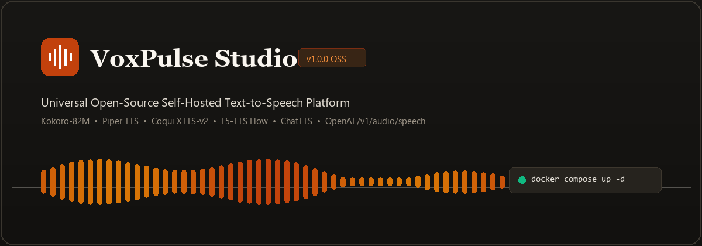
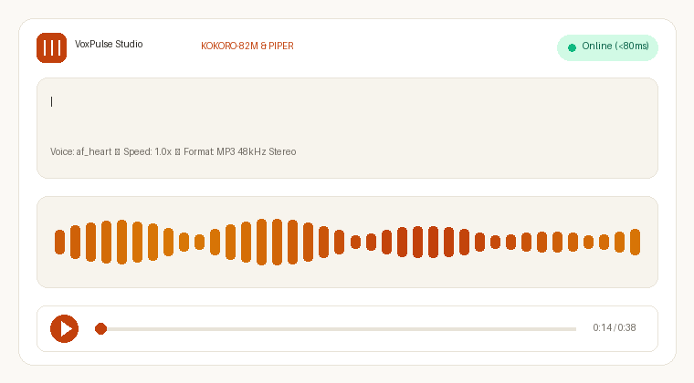
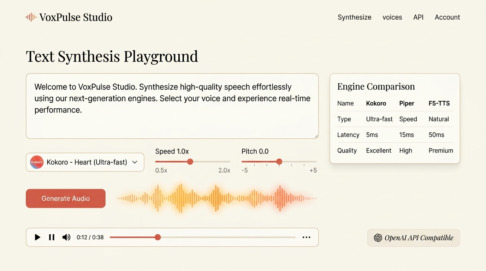
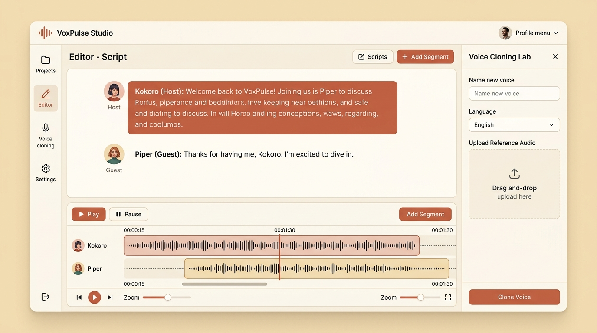
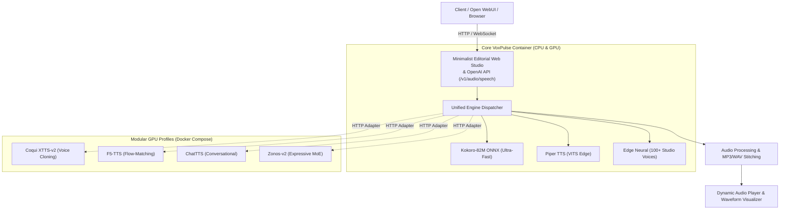

<p align="center">
  
</p>

<p align="center">
  <strong>The Universal Open-Source Self-Hosted Text-to-Speech Platform & Web Studio.</strong>
</p>

<p align="center">
  <a href="https://github.com/Varun-SV/voxpulse/blob/main/LICENSE"></a>
  <a href="https://www.python.org/"></a>
  <a href="https://www.docker.com/"></a>
  <a href="https://fastapi.tiangolo.com/"></a>
  <a href="https://platform.openai.com/docs/guides/text-to-speech"></a>
</p>

<p align="center">
  <a href="https://varun-sv.github.io/voxpulse/"></a>
</p>

---

## ⚡ Overview

**VoxPulse Studio** is an all-in-one, self-hostable speech platform that bridges the entire open-source neural TTS ecosystem into a single, unified Docker service and a warm, minimalist editorial web audio studio.

Instead of wrestling with fragmented repositories, conflicting CUDA runtimes, and differing APIs, VoxPulse gives you:
* **Out-of-the-Box Lightweight Engines**: State-of-the-art **Kokoro-82M** (ultra-fast ONNX), **Piper TTS** (Rhasspy edge VITS), and **Edge Neural** (100+ voices) running instantly on any standard CPU or GPU.
* **Heavyweight Microservice Adapters**: Seamless connectors for **F5-TTS** (flow-matching diffusion), **Coqui XTTS-v2** (zero-shot multilingual cloning), **ChatTTS** (conversational markers), and **Zonos-v2** (expressive MoE).
* **OpenAI Drop-In Compatibility**: Exposes `POST /v1/audio/speech`, allowing you to replace expensive cloud TTS in **Open WebUI**, **LibreChat**, **Home Assistant**, or **Obsidian** with a single base URL change.
* **Minimalist Editorial Studio**: Classic serif typography, warm parchment tones, interactive Web Audio API frequency visualizer, side-by-side engine shootout arena, and podcast script editor.

---

## 🎬 Live Interface & Demo

<p align="center">
  
</p>

<p align="center">
  
</p>

---

## 🌟 Key Capabilities

### 1. 🎙️ Text Synthesis Playground
* Real-time synthesis with live latency metrics (sub-80ms RTF).
* Sliders for speed multiplier (0.5x – 2.0x) and pitch offsets.
* Interactive HTML5 Canvas waveform visualizer driven by the browser's Web Audio API.
* Export to MP3 or lossless WAV.

### 2. ⚔️ Multi-Engine Shootout Arena
* Compare any phrase across **Kokoro-82M**, **Piper**, **Edge**, and **F5-TTS** side-by-side.
* Instant visual benchmarking of latency (ms) and audio prosody.

### 3. 👥 Multi-Speaker Dialogue & Podcast Studio
* Compose multi-character scripts (e.g., Host vs. Guest).
* Assign different voices, styles, and engines per line.
* Automatically synthesizes and stitches lines into a seamless master episode audio track.

### 4. 🧬 Zero-Shot Voice Cloning Lab
* Drag and drop a 3–10 second speaker audio sample.
* Synthesize custom speech conditioned on the speaker's vocal timbre.

<p align="center">
  
</p>

---

## 📊 Supported Engines Comparison Matrix

| Engine | Primary Architecture | Target Hardware | Min RAM / VRAM | Voice Cloning | Latency / RTF | Languages | License |
| :--- | :--- | :--- | :--- | :--- | :--- | :--- | :--- |
| **Kokoro-82M** | StyleTTS 2 / ONNX | CPU & GPU | 500 MB RAM | 40+ Pre-set Personas | &lt; 80ms (Ultra-Fast) | EN, JA, ZH, FR, ES, IT | Apache 2.0 |
| **Piper TTS** | VITS / Acoustic | CPU (Edge / RPi) | 100 MB RAM | Model Finetune | &lt; 50ms (Instant) | 40+ Languages | MIT |
| **F5-TTS** | Flow-Matching Diffusion | GPU (CUDA) | 4 GB VRAM | Zero-Shot (3s wav) | ~ 300ms (Natural) | EN, ZH, Multilingual | MIT |
| **Coqui XTTS-v2**| Autoregressive HiFi-GAN| GPU (CUDA) | 4 GB VRAM | Zero-Shot (17 langs) | ~ 400ms | 17 Languages | CPML |
| **ChatTTS** | Conversational Generative| GPU (CUDA) | 4 GB VRAM | Latent Seeds | ~ 350ms | EN, ZH | OSS |
| **Zonos-v2** | MoE Transformer | GPU (CUDA) | 6 GB VRAM | Prompt Conditioned | ~ 300ms | EN, Multilingual | Apache 2.0 |
| **Edge Neural** | Deep Neural Vocoder | Lightweight | None | 100+ Studio Voices | &lt; 120ms | 40+ Locales | Free |

---

## 🚀 Quickstart with Docker

### Option 1: Docker Compose (Recommended)

Clone the repository and launch the container:

```bash
git clone https://github.com/Varun-SV/voxpulse.git
cd voxpulse

# Start the core lightweight studio (runs on ANY CPU / machine)
docker compose up -d
```

Open your browser at **[http://localhost:8000](http://localhost:8000)**.

### Option 2: Docker Run Single Command

```bash
docker run -d \
  -p 8000:8000 \
  -v voxpulse-storage:/app/storage \
  --name voxpulse-studio \
  voxpulse:latest
```

### Option 3: Local Python Setup (Without Docker)

```bash
# 1. Clone & create virtual environment
git clone https://github.com/Varun-SV/voxpulse.git
cd voxpulse
python -m venv venv
venv\Scripts\activate   # On Windows
# source venv/bin/activate  # On Linux/macOS

# 2. Install dependencies
pip install -r backend/requirements.txt

# 3. Start VoxPulse
python run.py
```

---

## 🔌 OpenAI Drop-In API Guide

VoxPulse implements the standard `POST /v1/audio/speech` endpoint. Any application configured to use OpenAI speech can switch to VoxPulse with zero code changes.

### Python (OpenAI SDK)

```python
from openai import OpenAI

client = OpenAI(
    base_url="http://localhost:8000/v1",
    api_key="not-needed"
)

response = client.audio.speech.create(
    model="voxpulse-kokoro",  # or "tts-1", "voxpulse-piper", "voxpulse-f5"
    voice="alloy",            # automatically mapped to local af_heart
    input="Hello from self-hosted VoxPulse Studio!"
)

response.stream_to_file("speech.mp3")
```

### cURL

```bash
curl http://localhost:8000/v1/audio/speech \
  -H "Content-Type: application/json" \
  -d '{
    "model": "tts-1",
    "input": "Speech synthesized locally with zero cloud dependencies.",
    "voice": "alloy",
    "response_format": "mp3"
  }' \
  --output speech.mp3
```

### Open WebUI Integration

1. Go to **Settings** &rarr; **Audio** &rarr; **Text-to-Speech (TTS)**.
2. Select **OpenAI**.
3. Set **API Base URL** to `http://host.docker.internal:8000/v1` (or `http://localhost:8000/v1`).
4. Set **API Key** to `voxpulse`.
5. Set **Voice** to `alloy` or `af_heart`.

---

## 🏛️ System Architecture



---

## 🛠️ API Reference

| Endpoint | Method | Description |
| :--- | :--- | :--- |
| `/v1/audio/speech` | `POST` | OpenAI-compatible speech synthesis endpoint |
| `/v1/models` | `GET` | List available models |
| `/api/synthesize` | `POST` | Studio synthesis with custom pitch, speed, and format |
| `/api/compare` | `POST` | Multi-engine benchmark comparison |
| `/api/dialogue` | `POST` | Multi-speaker podcast & dialogue assembly |
| `/api/engines` | `GET` | Catalog of engines, hardware tiers, and status |
| `/api/voices` | `GET` | Catalog of all available voices with gender/locale filters |
| `/api/health` | `GET` | System health check |

---

## 📜 License

Distributed under the **Apache 2.0 License**. See [`LICENSE`](LICENSE) for details.

---

<p align="center">
  Crafted with care by <a href="https://github.com/Varun-SV">Varun S V</a>. Contributions and PRs welcome!
</p>
